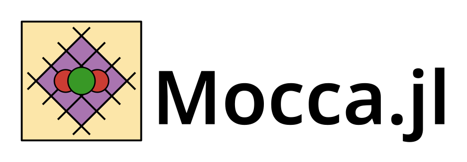

[](https://zenodo.org/badge/latestdoi/587234164)

# Mocca




[Mocca.jl](https://github.com/sintefmath/Mocca.jl) provides a [Julia](https://julialang.org/) based framework for the simulating pressure / temperature swing adsorption processes for CO2 capture. 

To learn more about using Mocca please see the [documentation](https://sintefmath.github.io/Mocca.jl/dev/).

Currently there is an implementation of a 4-stage vacuum swing adsorption process for CO2 capture, from a two-component flue gas, using Zeolite 13X and a dual-site Langmuir model. See [Haghpanah DCB](https://github.com/sintefmath/Mocca.jl/blob/main/examples/dcb_haghpanah_2013_co2_n2.jl) and [Haghpanah Cyclic VSA](https://github.com/sintefmath/Mocca.jl/blob/main/examples/cyclic_vsa_haghpanah_2013_co2_n2.jl). For an example of setting up a simulation through defining your own parameters and potentially custom models in a script, see [Custom setup cyclic VSA](https://github.com/sintefmath/Mocca.jl/blob/main/examples/custom_setup_cyclic_vsa.jl). Additionally, we have made examples demonstrating capabilities for doing [Optimization](https://github.com/sintefmath/Mocca.jl/blob/main/examples/optimization.jl) and [History matching](https://github.com/sintefmath/Mocca.jl/blob/main/examples/history_matching.jl) in Mocca.jl.

In the future we hope to implement examples of other systems and isotherms e.g. temperature swing adsorption for Direct Air Capture (DAC).

# Installation

Install Julia 1.10 or later from [julialang.org](https://julialang.org/downloads/). In a folder for your work, start Julia with `julia --project=.` and add Mocca, and CairoMakie for saving plots:

```julia
using Pkg
Pkg.add(url = "https://github.com/sintefmath/Mocca.jl", rev = "main")
Pkg.add("CairoMakie")
```

The version in Julia's package registry (0.1.0) has the earlier interface, so install from GitHub as above until the next release. The first run in a session takes a few minutes while Julia compiles. See the [installation guide](https://sintefmath.github.io/Mocca.jl/dev/installation/) for more.


# Quick start example
Run the following code to read the four-step vacuum swing adsorption (VSA)
process of Haghpanah et al. (2013) from Mocca's library, find its cyclic
steady state, and measure its performance:

```julia
using Mocca
using Mocca.Units

process = read_process("haghpanah_2013_four_stage_vsa")
process[:P_L] = 0.05bar              # a design variable: the evacuation pressure
result = cyclic_steady_state(process)
performance(result)                  # purity, recovery, specific energy, productivity
```

A process is described in layers, each of which can be edited and saved on
its own: a `Gas` and its `Feed`; an `Adsorbent` with its isotherm given by
component (`dual_site_langmuir`) and a `Column`; a `Flowsheet` of beds
(`add_bed!`) and devices with roles (`add_device!`); and a `Cycle` of steps
(`Pressurise`, `Adsorb`, `Blowdown`, `Evacuate`, `Purge`, `Equalise`, `Idle`,
or your own). Units are SI; `Mocca.Units` has conversions such as `bar` and
`kJ_per_mol`. See the [Custom setup cyclic VSA](https://github.com/sintefmath/Mocca.jl/blob/main/examples/custom_setup_cyclic_vsa.jl)
example for a process built from its parts, and the
[JSON input](https://github.com/sintefmath/Mocca.jl/blob/main/examples/json_input.jl)
example for the file format.

# Acknowledgements

The authors would like to thank Shreenath Krishnamurthy, SINTEF Industry and Gokul Subraveti, SINTEF Energy for assistance developing the code. 
This project has received funding from the following projects:
- SINTEF Digital Strategic Development Fund
- FME gigaCCS administered by the Research Council of Norway (350370). 
